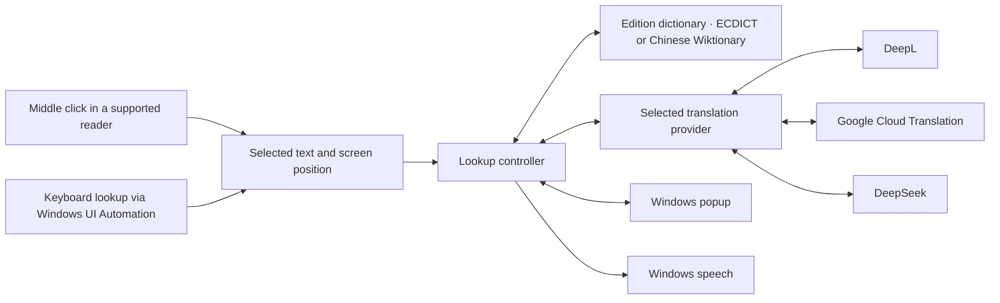

# Windows middle-click lookup panel

The first feature of this uTools alternative is for reading. Highlight a word, middle-click it, see its meaning, and hear how it is pronounced. Highlight a sentence and the same gesture translates it. The document stays open at the same line.

Windows and the middle-click behavior are design decisions. English to Simplified Chinese is the proposed first language pair.

## The reading experience

| What you middle-click | What happens |
| --- | --- |
| A highlighted word | A dictionary card opens beside the highlight. Click its speaker to hear the selected word. |
| A highlighted phrase or sentence | An exact dictionary phrase gets its own entry. Otherwise the card uses the reader’s chosen translation service when enabled. Choose a provider beneath the result to translate the same selection again. The speaker reads the original selection. |
| A link, empty space, or text with nothing selected | The reading app receives its ordinary middle click, including opening a link or starting autoscroll. |
| Somewhere outside an existing highlight in the foreground reader | A confirmed selection opens at the pointer. With middle-click lookup off, the reader receives the click. |

```text
yield    [🔊 /ji:ld/]

名词        生产量，投资收益
及物动词    出产，给予，让出，放弃，使屈服
不及物动词  出产，屈服，投降，倒塌
```

Selecting “The talks yielded little progress.” would show **会谈进展甚微。** in the same space. The original sentence is already visible on the page. The speaker plays on demand, with an accessible label such as “Pronounce yield.” If a reader selects *yielded*, the dictionary can use *yield* for the definition while the speaker says *yielded*. Show phonetics when the dictionary supplies them for the displayed form.

Place the card beside the clicked line, flipping at the monitor edge. Keep keyboard focus in the document, including while the speaker plays. Clicking or scrolling back in the document dismisses the card and delivers that input to the document. Opening another lookup replaces the card and stops the previous audio.

Use white surfaces, a light gray selection, and charcoal text. The card opens outward from the highlight over 160 ms and recedes toward it over 90 ms on dismissal. The document can receive input throughout dismissal. When the reader switches providers, a white indicator slides to the chosen service as the new translation settles into place. With reduced motion enabled, each change appears immediately.

## Windows architecture

Use a C#/.NET tray application with one lookup controller for all reading apps. A WPF window with the Win32 `WS_EX_NOACTIVATE` style lets the mouse-operated card receive clicks while the document keeps focus. The part specific to each reader is how it recognizes a selected-text click. [Windows non-activating windows](https://learn.microsoft.com/en-us/windows/win32/winmsg/extended-window-styles#ws_ex_noactivate)



**Recognize the gesture across Windows.** A dedicated message thread records a drag or double-click in the reader and handles middle-button presses. On explicit lookup, a worker asks the foreground reader to copy the highlight, reads the new clipboard text and restores the previous formats. Windows UI Automation supplies keyboard selections and a fallback when copying is unavailable. Its line rectangles refine card placement when available. Zed’s copy metadata distinguishes selected text from an automatic whole-line copy. An unconfirmed selection leaves the gesture with the reader. [Windows mouse hooks](https://learn.microsoft.com/en-us/windows/win32/winmsg/lowlevelmouseproc) · [Text range geometry](https://learn.microsoft.com/en-us/windows/win32/api/uiautomationclient/nf-uiautomationclient-iuiautomationtextrange-getboundingrectangles)

**Keyboard lookup.** Ctrl+Alt+L looks up the current highlight on a worker and opens a focusable card. It uses the same copy operation after a selection gesture and can read the focused control’s text range for keyboard-created selections. The card anchors to the pointer when the app omits selection geometry. [Windows text selection](https://learn.microsoft.com/en-us/windows/win32/api/uiautomationclient/nf-uiautomationclient-iuiautomationtextpattern-getselection)

**Dictionary.** Offline looks up exact words, phrases and inflections in the bundled ECDICT SQLite index. Online requests the selected word or short phrase through Chinese Wiktionary’s public API and links the displayed senses to their article and license. Both editions fit the card to its content and keep the headword and pronunciation in view as the definitions scroll. Replacing or dismissing a selection cancels the lookup. For a missing word, offer “翻译所选内容.” [ECDICT fields](https://github.com/skywind3000/ECDICT#数据格式) · [MediaWiki parsing API](https://www.mediawiki.org/wiki/API:Parsing_wikitext)

**Translation service choice.** Put the provider switch directly under the translation. Choosing DeepL, DeepSeek, or Google Cloud reruns the current selection and saves that choice for subsequent translations. Keep the highlight, card position, and original-language audio available during the switch.

The providers accept the selected text, source language, target language, and a cancellation token. The Windows host owns the credentials for each service and sends the text only to the provider the reader selects.

- **DeepL** uses the Free or Pro text translation endpoint for the configured key. [DeepL Translate API](https://developers.deepl.com/api-reference/translate/request-translation)
- **DeepSeek** uses its chat completions endpoint with the configured model. The system message specifies the target language and requests just the translation. The user message contains the selected text. [DeepSeek Chat Completions API](https://api-docs.deepseek.com/api/create-chat-completion/)
- **Google Cloud** sends plain text to the Cloud Translation Basic (v2) endpoint. It uses the configured API key or the same Google application credentials and quota project as pronunciation. [Cloud Translation Basic API](https://docs.cloud.google.com/translate/docs/reference/rest/v2/translate)

Each provider change starts a new request ID and cancels the previous translation. Only the current request can update the card. If the chosen service needs a key, open its setup in the host. If a request fails, offer retry and let the reader choose the other provider.

**Pronunciation.** Use an installed Windows voice matching the source language. Playback can start as soon as the card knows the selection, even while a translation is pending. If the voice is missing, keep the definition visible and offer voice setup. [Windows speech synthesis](https://learn.microsoft.com/en-us/uwp/api/windows.media.speechsynthesis.speechsynthesizer)

Keep the active selection in memory for the lifetime of the card. Give each lookup an ID and accept translation or speech results only for the currently open lookup. A future action such as “Search this phrase” can reuse the same selected text and position while dictionary lookup stays one click away.

## First validation

Start with ordinary browser text and one named desktop or PDF reader used for daily reading. Treat each reader’s selection support as something to verify on that reader.

| Trial | Proposed acceptance criterion |
| --- | --- |
| Middle-click a selected word with the network disconnected | A warm local lookup shows a definition within 200 ms at the 95th percentile over 100 trials. The speaker plays the selected form with an installed voice. |
| Clear the highlight and immediately middle-click a link, then try a blank area | The link opens once and the blank area starts normal autoscroll. Neither gesture opens a card. |
| Select a sentence, trigger translation, then look up another word | The second card stays visible when the first translation finishes. |
| Switch a sentence from Google Cloud to DeepSeek, then select a different sentence | The current translation updates in place. The next sentence uses DeepSeek. A late Google Cloud response is discarded. |
| Look up text near a monitor edge, play it, and continue reading | The card fits on the monitor, the source keeps focus, and the next document click works on the first try. |

The 200 ms figure is a design target for local dictionary lookup. The [Windows implementation](README.md) supports English-to-Chinese lookup in apps that expose selected text through Windows UI Automation.
